# microllm

A small language model in plain Rust, with no libraries, where every number
of training can be looked at: the loss falling, the text it writes, the arithmetic of one
training step, and the valley the weights walked down.

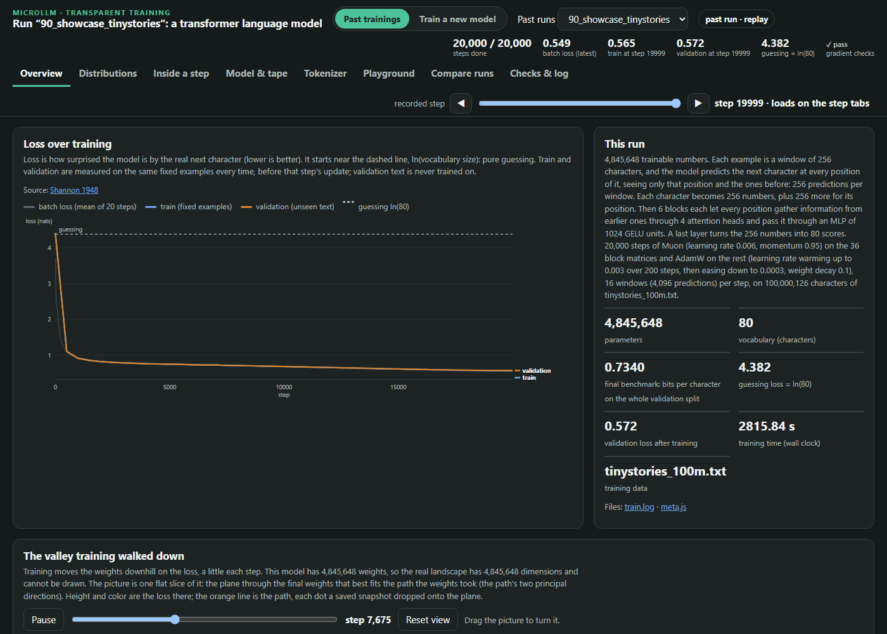

## Start here

1. **Get it:** click the green **Code** button on this page, then **Download ZIP**, and unzip it
   (or `git clone` it).
2. **Install Rust** once, from <https://rustup.rs> (the default answers are fine).
3. **Double-click `START_HERE.bat`** (Windows) or **`START_HERE.command`** (Mac; Linux: run it
   from a terminal). The first start builds microllm, which takes about a minute.

Your browser opens a page with two choices:

- **Explore a trained model:** a 4.8-million-weight transformer that learned to write
  children's stories from [TinyStories](https://arxiv.org/abs/2305.07759).
- **Train my first model:** a small transformer reads Shakespeare and learns to write like it,
  in about two minutes, while you watch.

Keep the black window open while you use the page; closing it stops microllm.

Just curious how one training step works? Open
[`inside-one-training-step.html`](inside-one-training-step.html) in your browser. It needs
nothing else.

## What it looks like

The pictures show the program and the runs included in this repository.

**The studio** checks your computer, suggests settings that fit it, and starts training. Each
setting has a **?** with a plain-language answer.

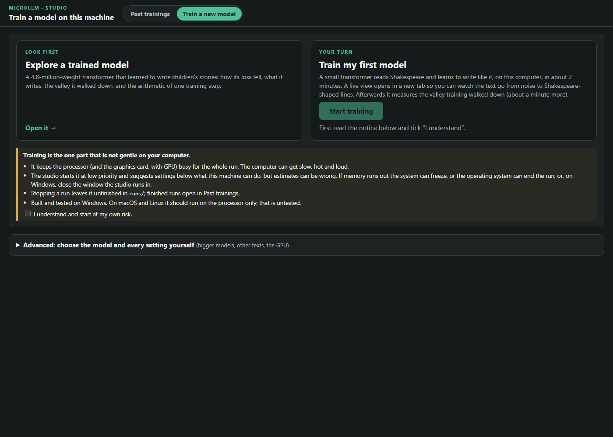

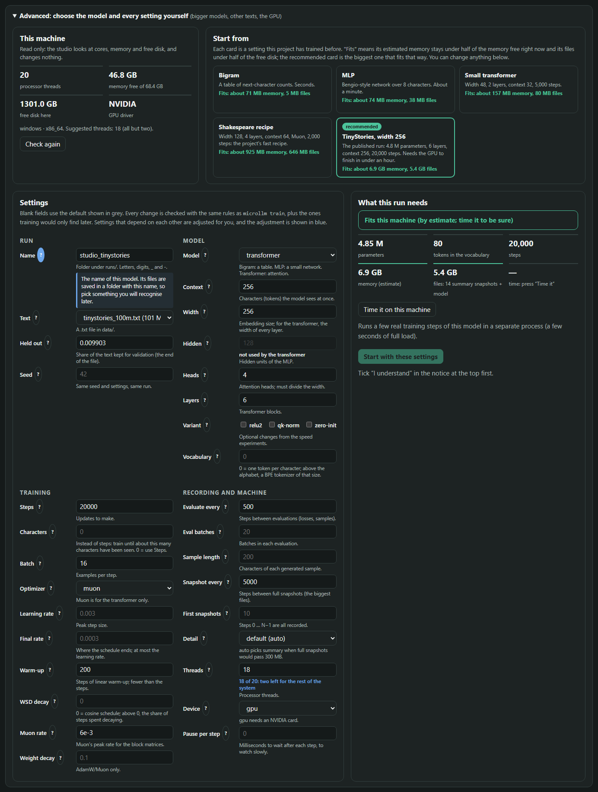

**The playground** runs the trained model in your browser, after checking that it gives the
same numbers as the Rust code.

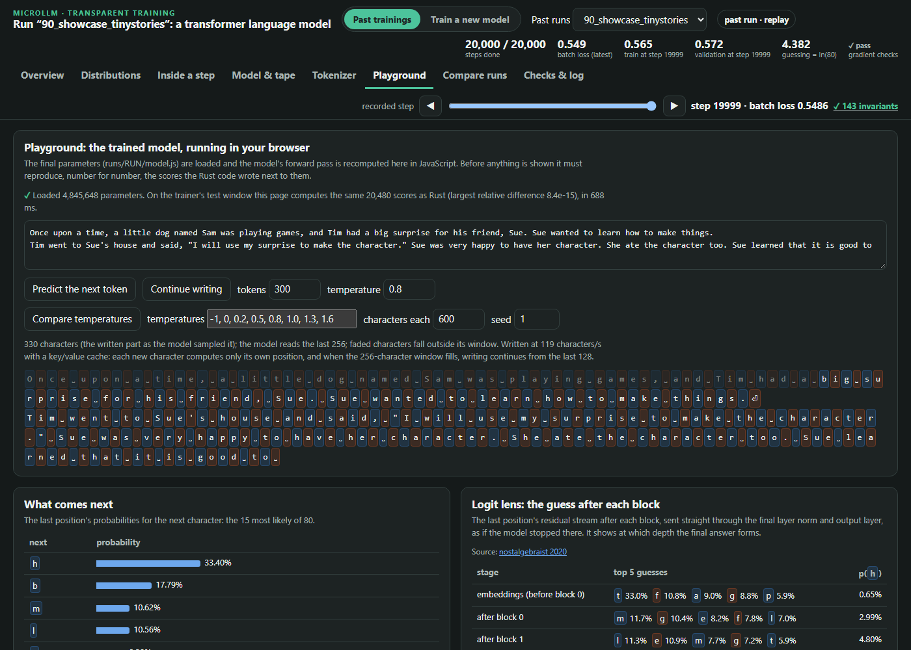

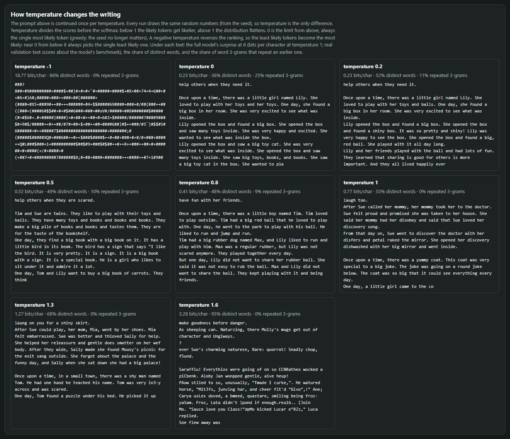

**The valley** shows a flat slice of the loss around the path the weights took during
training.

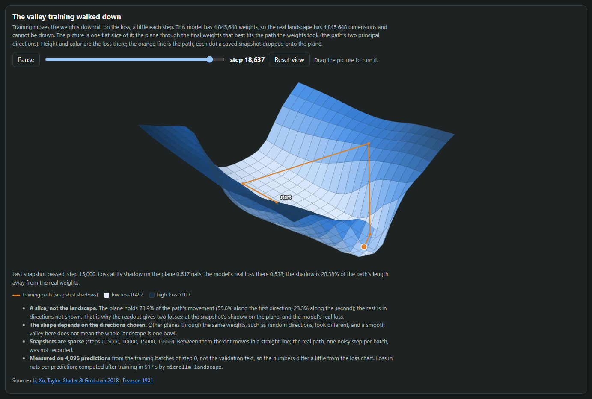

<details>
<summary>More: one training step, attention, the tokenizer, comparing runs, the lesson</summary>

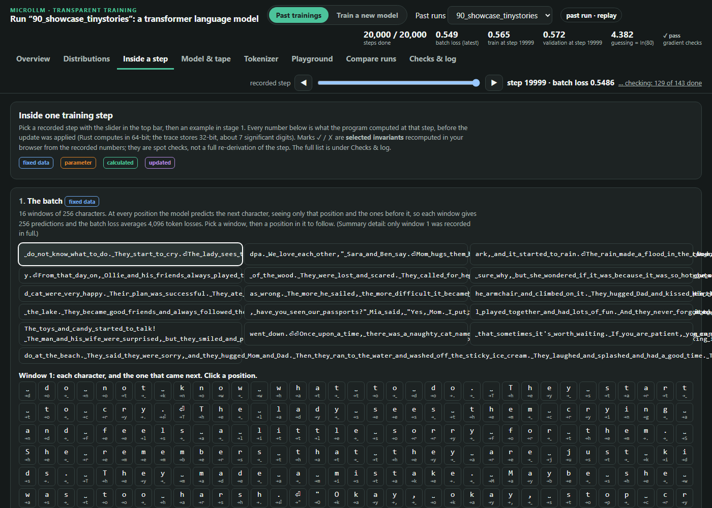

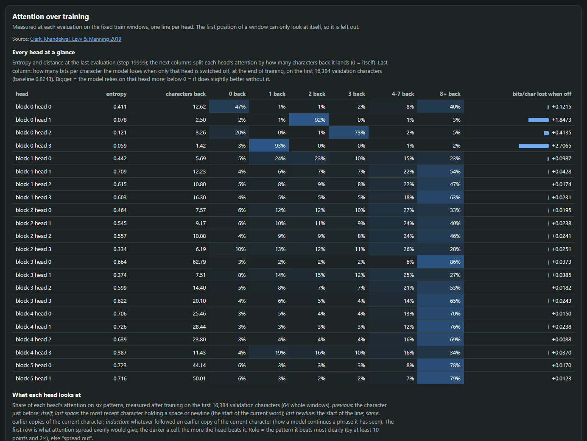

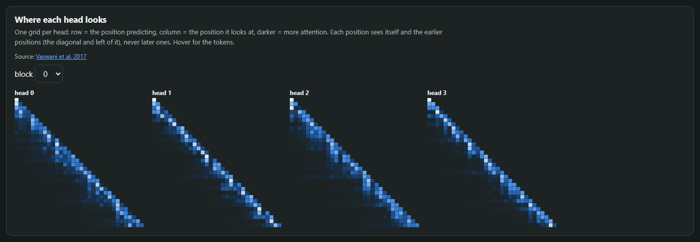

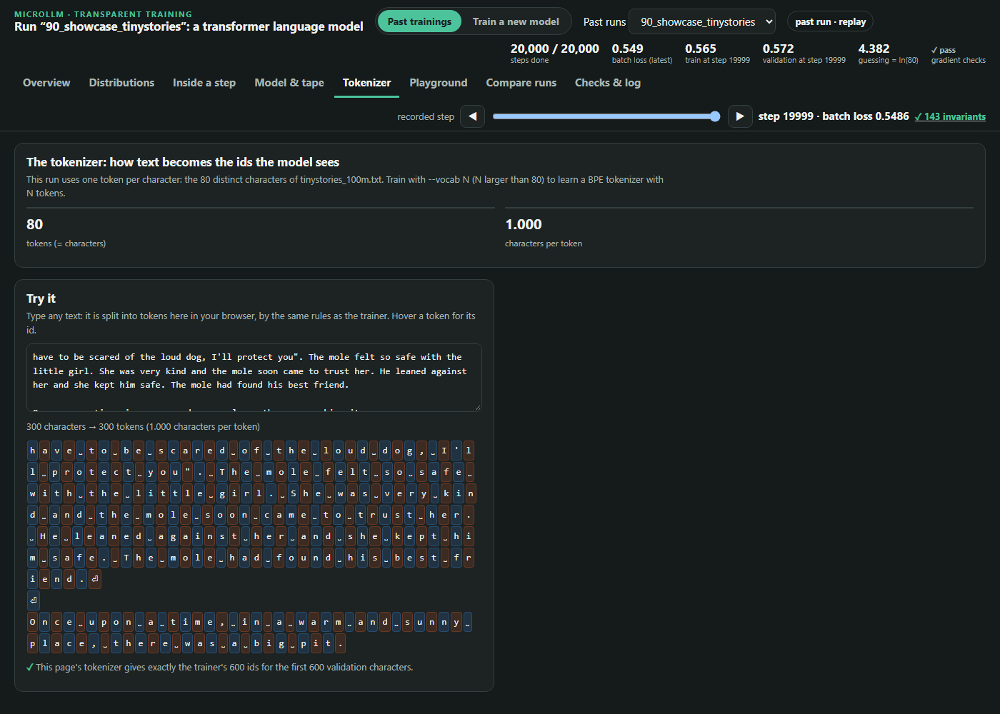

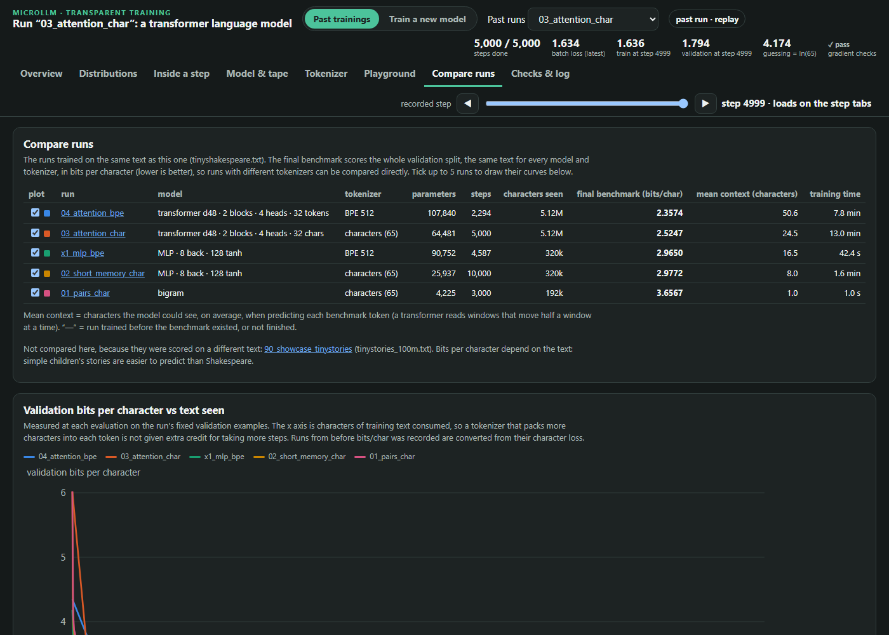

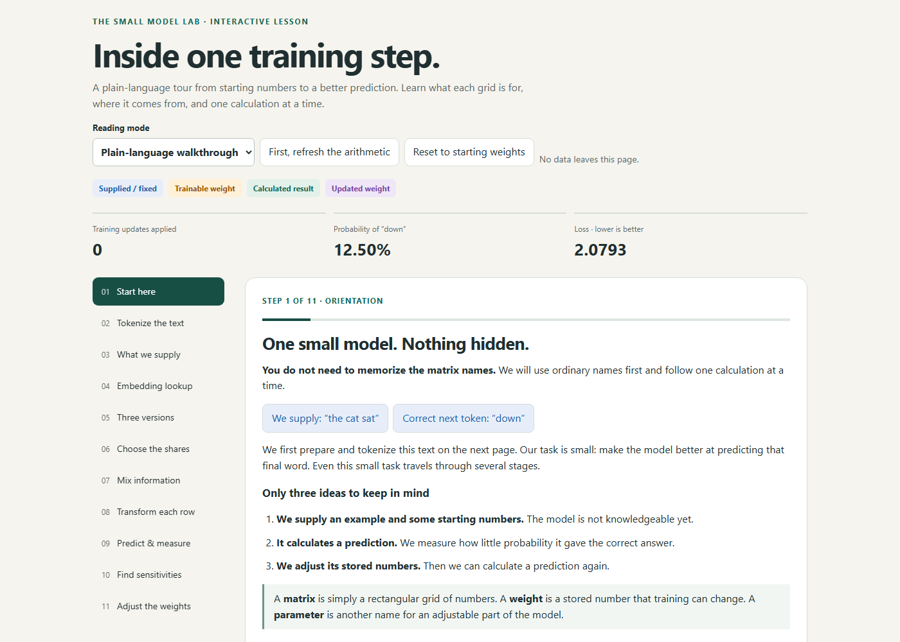

</details>

## The trained models, in order

The runs in `runs/` tell one story: how a model goes from guessing letters to writing
sentences. The first five read the same text, Tiny Shakespeare, and each step changes one main
thing. The number in the name is its place in the story; `x1` is a side
experiment, and `90` is the epilogue.

Every model starts out writing noise like `Aev?IeyzrwW3&SbO`. The score is **bits per
character**: roughly, how many yes-or-no questions the model still needs to pin down each next
letter. Pure guessing among Shakespeare's 65 characters costs about 6; lower is better.

| Run | What changes | Size (weights) | Training | Bits per character |
|---|---|---:|---:|---:|
| `01_pairs_char` | Looks only at the previous letter | 4,225 | 1 s | 3.66 |
| `02_short_memory_char` | Remembers the last 8 letters | 25,937 | 1.6 min | 2.98 |
| `x1_mlp_bpe` | Side note: the same model, reading word-pieces | 90,752 | 42 s | 2.97 |
| `03_attention_char` | Attention: it can look back at any of 32 letters | 64,481 | 13 min | 2.52 |
| `04_attention_bpe` | The same transformer, reading word-pieces | 107,840 | 8 min | 2.36 |
| `90_showcase_tinystories` | Bigger, and a simpler text: children's stories | 4,845,648 | 47 min | 0.73* |

1. **Pairs.** A table that counts which letter tends to follow which. It learns that
   Shakespeare has short words, names in capitals and colons, but nothing more:
   *"And ayo, thengreanurdowourerimy."*
2. **Short memory.** A small neural network (an MLP) that sees 8 letters at once. Words start
   to look like words, and the play's layout appears: *"Go hon and puparen let in he powert
   flow."*
3. **Side note: word-pieces for the MLP.** Feeding it chunks of words instead of letters
   barely helped (2.97 against 2.98), even though its 8 pieces now cover about 16.5 letters
   instead of 8 and it has more weights. One plausible reason is that a model this small
   cannot make much use of the extra reach.
4. **Attention.** A small transformer, the design behind today's language models. Each
   letter can look back at any earlier one and choose what matters, and the score drops by
   half a bit: *"my gurncer then free arel too be unmen, Isand tone?"*
5. **Attention with word-pieces.** The same design reading word-pieces, with a larger
   vocabulary and so more weights. This time the chunks help: its 32 pieces cover about 66
   letters instead of 32, and attention can plausibly use that longer reach:
   *"The lady and my licghbery,-camned we resape."*
6. **Epilogue: TinyStories.** A transformer about 45 times bigger, trained for 47 minutes on
   a GPU on simple children's stories. It writes whole sentences that mostly make sense:
   *"Once upon a time, there was a white dog named "and he lived in his house. His name is Tom.
   He loved to crawl on the couch."* It is the model behind **Explore a trained model**.

\* Measured on a different, easier text, so this number cannot be compared with the
Shakespeare runs. The viewer's **Compare runs** tab puts the five Shakespeare runs on one
chart.

The runs were renamed for this repository after training, and each `train.log` keeps the name
it was trained under: `lad_bigram` is `01_pairs_char`, `lad_mlp` is `02_short_memory_char`,
`lad_mlp_bpe512` is `x1_mlp_bpe`, `lad_tf_char` is `03_attention_char`, `lad_tf_bpe512` is
`04_attention_bpe`, and `ts_d256_L6_muon` is `90_showcase_tinystories`.

## Good to know

- Everything runs on your computer. The page listens on `127.0.0.1` only, and nothing is
  uploaded.
- Training keeps the processor busy, so the computer can get slow, hot and loud. The page
  says what a run needs before it starts, and it can stop a run at any time.
- Built and tested on Windows. macOS and Linux should run on the processor only; that is
  untested. With an NVIDIA graphics card and the CUDA toolkit installed, microllm can also
  train on the GPU.
- Windows or macOS may warn about a program from an unknown publisher the first time.
  That warning is about microllm being new and unsigned.

## For programmers

```
cargo run --release                     # the studio (the same as START_HERE)
cargo run --release -- gradcheck        # check every gradient against finite differences
```

The full command list is at the top of [`src/main.rs`](src/main.rs). Each run writes
`runs/<name>/`, which `viewer/index.html` reads.

- `src/`: the model, automatic differentiation, optimizers (SGD, AdamW, Muon), tokenizers
  (characters and BPE), the training loop, the trace writer and the local servers.
  There are no dependencies beyond the Rust standard library; the optional GPU path is
  built only when `nvcc` is found.
- `viewer/`: two static pages. `studio.html` starts runs; `index.html` shows them.
- `data/`: Tiny Shakespeare (included; see Credits). For TinyStories, download the
  TinyStoriesV2-GPT4 text files and build the corpus with
  `python -I data/prepare_tinystories.py` (usage at its top).
- `runs/`: the six finished runs (see [The trained models, in order](#the-trained-models-in-order)).
  Their step-by-step snapshots are left out to keep the download small; runs you train keep
  theirs.
- [`docs/papers/README.md`](docs/papers/README.md): the papers behind each technique, and
  where each one lives in the code.

## Credits and AI use

microllm was designed and directed by jibarix. Much of its code and text was written with AI
coding assistants: Claude Code (Anthropic) wrote and edited code, pages and documentation
under my direction, and OpenAI's Codex reviewed the work and cross-checked the citations. I
tested the result and take responsibility for it.

- **Tiny Shakespeare** (`data/tinyshakespeare.txt`) is the text from Andrej Karpathy's
  [char-rnn](https://github.com/karpathy/char-rnn) (MIT license), included unchanged.
- **TinyStories** is by Ronen Eldan and Yuanzhi Li
  ([paper](https://arxiv.org/abs/2305.07759),
  [dataset](https://huggingface.co/datasets/roneneldan/TinyStories)), licensed under
  [CDLA-Sharing-1.0](https://cdla.dev/sharing-1-0/). The showcase run was trained on it, and
  its `meta.js` and `model.js` hold short example passages from the dataset's validation
  stories.
- The ideas behind each technique are credited in
  [`docs/papers/README.md`](docs/papers/README.md) and in the viewer's Sources panel. The
  optional transformer variants (relu2, qk-norm, zero-init) and the Muon optimizer were picked
  from Keller Jordan's [modded-nanoGPT](https://github.com/KellerJordan/modded-nanogpt)
  speedrun records.

## Security, contributing and versions

microllm runs local servers and starts processes on your computer; [SECURITY.md](SECURITY.md)
lists exactly what it does and how to report a problem privately. Pull requests are open to
invited collaborators only; see [CONTRIBUTING.md](CONTRIBUTING.md). Each release is tagged
(`v0.1.0` is the first), and [CHANGELOG.md](CHANGELOG.md) lists what changed.

## License

The original code and documentation are MIT; see [LICENSE](LICENSE). The datasets and other
third-party material keep their own terms (see Credits).
